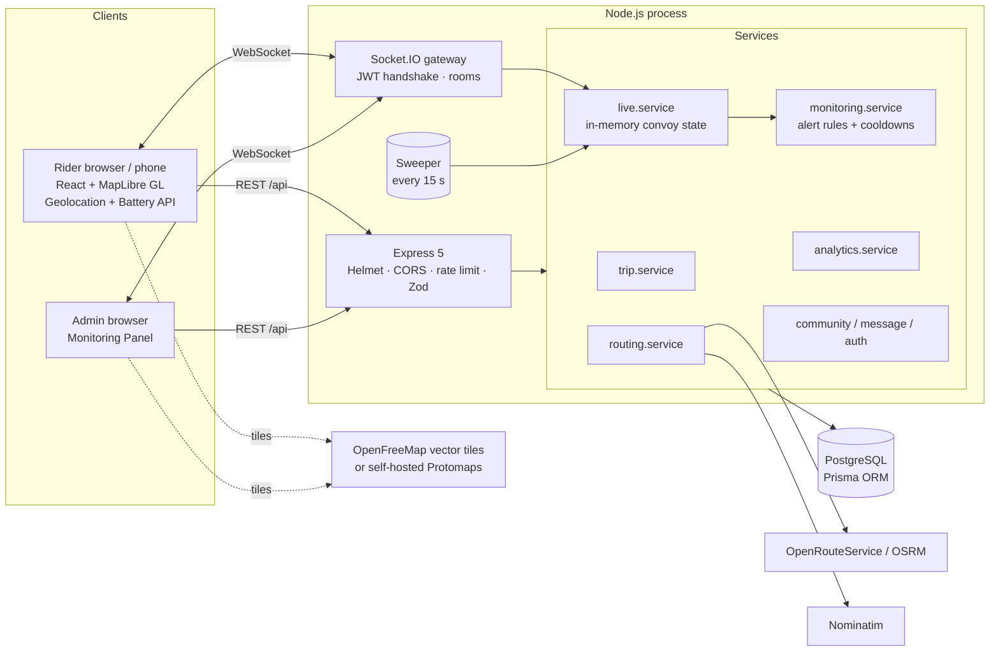
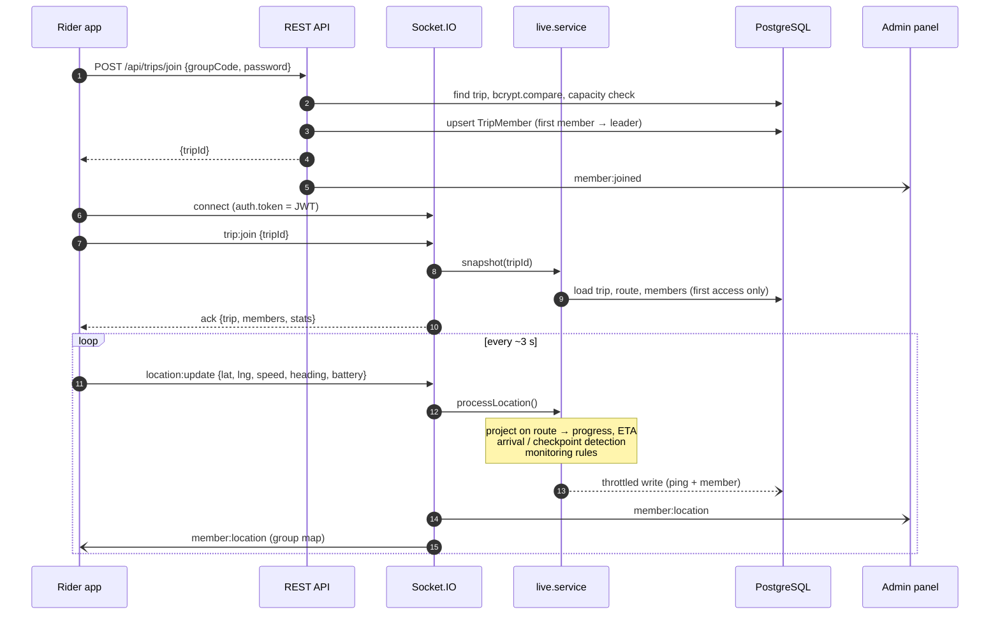
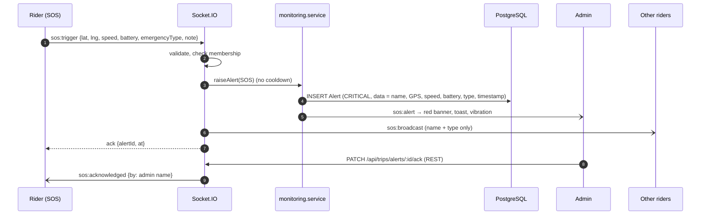
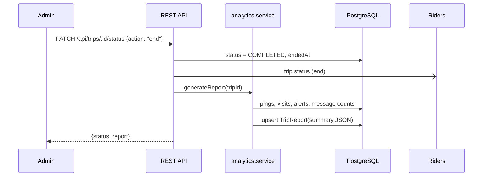

# NavNet architecture

## System architecture

**Why this shape**

- **REST for state changes that need a durable answer** (create trip, join, pause, remove member), and **WebSockets for streams** (GPS pings, chat, alerts). Every socket event has an ack callback, so the client always knows whether its ping or SOS landed.
- **The hot path runs in memory.** Each GPS ping is projected onto the route, turned into progress, ETA, arrival and checkpoint events, and checked against monitoring rules without touching Postgres. Positions are persisted on a throttle (`PING_PERSIST_SECONDS`), so a 50-rider convoy pinging every 3 seconds costs about 5 writes a second instead of 17.
- **Postgres is the source of truth.** If the process restarts, `live.service` rebuilds each trip's state from `TripMember` (last position, progress) and `CheckpointVisit` the first time anyone touches that trip.
- **Map data never touches Google.** Tiles come straight from OSM (recoloured with CSS in dark mode, no API key). Routing and geocoding are proxied through the API, so we can set a compliant User-Agent, cache results, rate-limit, and fall back from ORS → OSRM → straight line.

## Real-time design

### Rooms

| Room | Members | Used for |
| --- | --- | --- |
| `trip:<id>` | everyone in the trip + its admin | locations, group chat, status changes, announcements |
| `trip:<id>:admin` | the trip admin's sockets | alerts, SOS, convoy stats |
| `user:<id>` | every socket of one user (multi-tab / multi-device) | private chat, "you were removed", SOS acknowledgements, rider notices |

### Sequence: join a trip and go live

### Sequence: SOS

### Sequence: end trip → analytics

## Smart monitoring rules

All rules live in `server/src/services/monitoring.service.js` (evaluated per ping) and the sweeper in `live.service.js` (evaluated on a timer, for things that happen when *no* ping arrives).

| Alert | Trigger | Guard against false alarms |
| --- | --- | --- |
| **Off route** | Distance to the route polyline > `OFF_ROUTE_METERS` | Must hold for 2 consecutive pings (filters GPS spikes) |
| **Stationary** | Moved < 30 m for > `STATIONARY_MINUTES` | Suppressed within `CHECKPOINT_METERS` of a planned checkpoint; only while online |
| **Offline** | No ping for > `OFFLINE_SECONDS` | Raised by the sweeper once per outage, reset on the next ping |
| **Low battery** | Battery < `LOW_BATTERY_PERCENT` | Fires once; re-arms only after recovering 5 points |
| **Overspeed** | Speed > the trip's own speed limit | Cooldown |
| **Wrong direction** | Moving on-route, and progress dropped > `WRONG_DIRECTION_METERS` below the max of the **last 2 minutes** | Sliding window, so a rider who turned back once isn't flagged for the rest of the trip |
| **SOS** | Rider presses SOS | Never rate-limited or deduplicated |

All rules except SOS share a per-(rider, type) cooldown (`ALERT_COOLDOWN_SECONDS`). Route rules are suppressed while a trip is `PLANNED` or `PAUSED`.

**Route projection.** Each ping is projected onto the polyline with a local equirectangular approximation per segment (well under 1 m error at convoy scale, and far cheaper than geodesic projection). The search is windowed around the rider's previous progress, so routes that loop back near themselves (out-and-back rides, switchbacks) don't make progress jump between legs.

**Checkpoint detection.** A checkpoint counts as visited when the rider passes within `CHECKPOINT_METERS`, **or** when progress crosses the checkpoint's position on the route between two pings. The second condition catches sparse pings at highway speed that would otherwise jump right over the radius.

## Scaling beyond one process

The single-process design comfortably handles hundreds of concurrent riders. To go horizontal:

1. **Socket.IO Redis adapter** (`@socket.io/redis-adapter`) so room broadcasts reach sockets on any instance.
2. **Sticky sessions** at the load balancer (needed for Socket.IO's polling fallback).
3. **Move `live.service` state to Redis**, or shard trips by `tripId`, so all pings for a trip land on the instance that owns it.
4. **Run the sweeper once**, behind a Redis lock or as a separate worker.
5. **Self-host OSRM and Nominatim.** The public demo servers are rate-limited and not meant for production traffic.
6. Partition or TTL `LocationPing` by month once history grows. Analytics only needs the pings of completed trips.

## Folder structure

### Client (`client/src`)

| Folder | Why it exists |
| --- | --- |
| `components/ui` | Design-system primitives with no business logic: `Field` (label + input + error, ARIA-wired), `Modal` (focus management, Escape, mobile sheet), `Milestone` (the signature km-stone), `Skeleton`, `StatusPill`, `RoadProgress`. |
| `components/map` | Everything map. `gl.jsx` is a small React layer over MapLibre GL with the same shape as react-leaflet (`Marker`, `Popup`, `Tooltip`, `Polyline`, `useMap`). `mapStyles.js` picks the map (self-hosted Protomaps → OpenFreeMap → OSM raster), and loads every tile, font and sprite through an `nncache://` protocol backed by Cache Storage, which is what makes offline maps work. `icons.js` builds HTML pin descriptors, `MapHelpers` fits/follows (incl. 3D heading-up). |
| `components/trip`, `chat`, `community` | Feature components shared by several pages (e.g. `ChatPanel` serves both the rider dashboard and the admin panel). |
| `components/layout` | `LiveShell` is the map-first frame: desktop side panel, or a mobile bottom sheet. The panel mounts once either way. |
| `pages` | One file per route. Pages compose components and hooks and hold page-level state only. |
| `hooks` | Reusable stateful logic. `useTripLive` is the single source of truth for a live trip: REST snapshot plus socket subscriptions, with re-joining on reconnect. |
| `context` | App-wide state: auth session, a single authenticated socket, theme. |
| `services` | The only place that knows URLs. Axios unwraps the `{success, data}` envelope and normalises errors. |
| `routes` | Route table with code-splitting, and `ProtectedRoute` for role gating. |
| `utils` | Pure functions (formatting, constants, geo), unit-tested. |

### Server (`server/src`)

| Folder | Why it exists |
| --- | --- |
| `config` | Reads and validates environment once; the process refuses to start without `DATABASE_URL`/`JWT_SECRET`. |
| `routes` → `controllers` → `services` | Routes declare middleware (auth, role, validation); controllers translate HTTP to service calls; services hold all business rules and are reused by the socket gateway. |
| `middleware` | Cross-cutting concerns: JWT auth + RBAC, Zod validation, rate limiting, uploads, error rendering. |
| `validation` | Zod schemas for REST bodies, queries and socket payloads, all in one place. |
| `socket` | `index.js` is the gateway (handshake auth, event handlers with acks). `emitter.js` lets services emit without importing Socket.IO, which keeps them testable. |
| `database` | Prisma client construction (Prisma 7 with the `pg` driver adapter). |
| `utils` | Geo math, password/JWT helpers, `ApiError`. |
| `models` | Data models are defined declaratively in `prisma/schema.prisma`, which generates the typed client. That is the project's model layer. |
