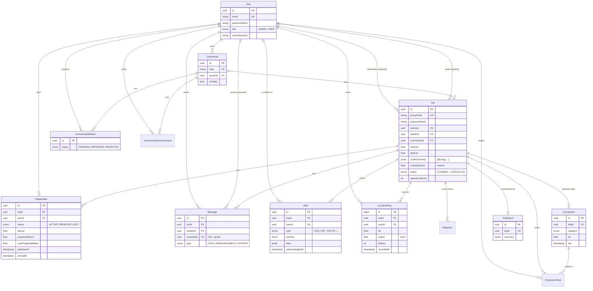

# NavNet database

PostgreSQL, managed with Prisma ORM 7. The source of truth is [`server/prisma/schema.prisma`](../server/prisma/schema.prisma). A plain-SQL equivalent for reading or running without Prisma is in [`schema.sql`](schema.sql).

## ER diagram



## Tables

| Table | Purpose | Notes |
| --- | --- | --- |
| `User` | Admins and riders | `role` drives RBAC; `email` unique (lower-cased on input) |
| `Trip` | A planned journey | `groupCode` unique; `passwordHash` = bcrypt of the group password; route stored as JSONB `[[lat,lng]]` with distance (m) and duration (s) |
| `Waypoint` | Points the route must pass | Ordered by `order` |
| `Checkpoint` | Planned stops (fuel, breakfast, hospital…) | Unlimited per trip; optional ETA |
| `TripMember` | Rider ↔ trip membership plus **last known live state** | Unique `(tripId, userId)`. `progressMeters` / `maxProgressMeters` let the live engine resume after a restart |
| `LocationPing` | Throttled GPS history | `BIGSERIAL` key; composite index `(tripId, userId, recordedAt)` serves analytics |
| `CheckpointVisit` | Who reached which checkpoint, and when | Unique `(checkpointId, userId)`, so visits are idempotent |
| `Message` | Group chat, private chat, announcements, system lines | `recipientId NULL` = visible to the whole trip |
| `Alert` | Monitoring + SOS events | `data` JSONB holds rule-specific context (SOS: name, GPS, speed, battery, type, timestamp) |
| `TripReport` | Frozen analytics summary | One per trip, JSONB, written when the trip ends |
| `Community` | Public clubs | `slug` unique for pretty URLs |
| `CommunityMember` | Join requests and membership | Unique `(communityId, userId)`; status workflow PENDING → APPROVED / REJECTED |
| `CommunityAnnouncement` | Community news | Indexed by `(communityId, createdAt)` |
| `Expense` | Shared ride costs | `amountPaise` integer (no float money); `splitAmong` JSONB user ids |

Group-riding columns: `User.bloodGroup / emergencyName / emergencyPhone / medicalNotes` (emergency card, shown to captains and SOS helpers only); `Trip.sweepId`, `gapAlertMeters` (default 1500), `meetLat/meetLng/meetName/meetSetAt`, `departAt`, `pois` + `poisAt` (cached Overpass results); `TripMember.checklist` + `readyAt`; `Message.audioUrl` + `durationMs` (type `VOICE`).

## Design decisions

- **UUID primary keys** everywhere a URL or token can expose an id (no enumeration). `LocationPing` uses `BIGSERIAL` because it's the highest-volume table and is never exposed.
- **Route geometry as JSONB, not PostGIS.** The app only ever reads the whole polyline for a trip, and all projection maths runs in Node against the in-memory copy. PostGIS would be the next step for spatial queries across trips ("riders within 5 km of me").
- **Live state is denormalised onto `TripMember`.** The hot path doesn't need joins, and a restart can rebuild in-memory state with a single query.
- **Soft membership states (`REMOVED`, `LEFT`)** instead of deletes. Removed riders can't rejoin with the Group ID, and analytics still include everyone who rode.
- **Cascades:** deleting a trip removes its members, pings, messages, alerts and report. Deleting a user nulls `Trip.leaderId` and `Alert.userId`, so history survives.
- **Group passwords are hashed** like account passwords. Even a database leak doesn't reveal how to join active trips.

## Migrations & seed

```bash
cd server
npx prisma migrate dev --name init   # first time: creates prisma/migrations and the tables
npx prisma migrate deploy            # production: apply committed migrations
npm run db:seed                      # idempotent demo data
npx prisma studio                    # browse data in the browser
```
